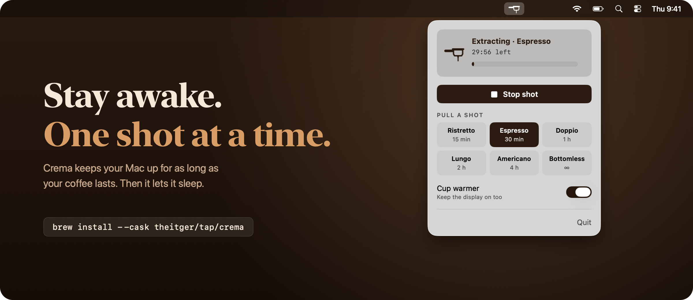
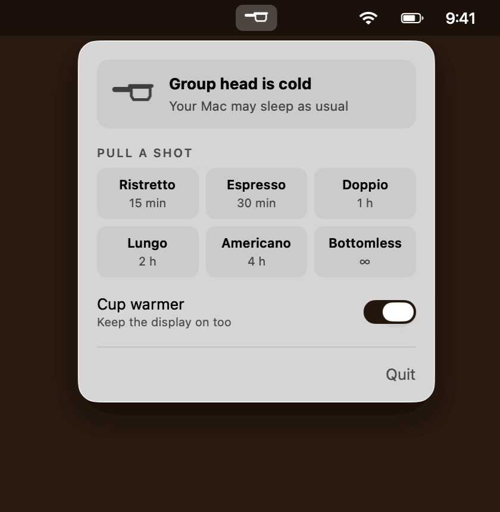

<p align="center">
  
</p>

<h1 align="center">Crema</h1>

<p align="center">
  The keep-awake app for people who measure time in espresso.
</p>

<p align="center">
  <a href="https://github.com/theitger/crema/releases/latest"></a>
  
  
  <a href="LICENSE"></a>
</p>

<p align="center">
  
</p>

<br>

## Get it

```sh
brew install --cask theitger/tap/crema
```

Or download the zip from the [latest release](https://github.com/theitger/crema/releases/latest).

<br>

## Pull a shot

Click the portafilter in your menu bar and pick your size. Coffee starts to pour, your Mac stays up. When the shot is done, Crema gets out of the way and your Mac goes back to sleeping like it always does.

<p align="center">
  
</p>

| Shot | Time | Good for |
| :--- | :--- | :--- |
| **Ristretto** | 15 min | A quick call |
| **Espresso** | 30 min | That one long article |
| **Doppio** | 1 h | The big download |
| **Lungo** | 2 h | A deep work block |
| **Americano** | 4 h | The render you're not babysitting |
| **Bottomless** | ∞ | Until you say stop |

<br>

## Why Crema

<table>
  <tr>
    <td width="33%" valign="top">
      <h4>Out of the way</h4>
      Lives in the menu bar. No Dock icon, no windows, no settings screen to get lost in.
    </td>
    <td width="33%" valign="top">
      <h4>Never stuck awake</h4>
      Every shot ends on time. If Crema quits or crashes, your Mac goes back to normal on its own.
    </td>
    <td width="33%" valign="top">
      <h4>Cup warmer</h4>
      Keep the display on too, or just the Mac. Flip it once and Crema remembers.
    </td>
  </tr>
  <tr>
    <td width="33%" valign="top">
      <h4>Live countdown</h4>
      Time left and a progress bar, right under the icon. Stop early with one click or ⌘ .
    </td>
    <td width="33%" valign="top">
      <h4>Built on caffeinate</h4>
      No helpers, no daemons, no kernel extensions. Just the tool Apple already ships, wrapped nicely.
    </td>
    <td width="33%" valign="top">
      <h4>Tiny and private</h4>
      Under 1 MB. No network access, no analytics, no account.
    </td>
  </tr>
</table>

<br>

## FAQ

<details>
<summary><b>Does it keep my MacBook awake with the lid closed?</b></summary>
<br>
No. Crema stops your Mac from dozing off while you're not touching it. Closing the lid still puts it to sleep, the way it should.
</details>

<details>
<summary><b>macOS says it can't verify Crema. Is that a problem?</b></summary>
<br>
Crema is signed, but not notarized by Apple. Homebrew handles this for you. If you installed from the zip, allow it once under <b>System Settings &gt; Privacy &amp; Security &gt; Open Anyway</b>, or run:

```sh
xattr -dr com.apple.quarantine /Applications/Crema.app
```
</details>

<details>
<summary><b>How do I start Crema at login?</b></summary>
<br>
Add it under <b>System Settings &gt; General &gt; Login Items</b>.
</details>

<details>
<summary><b>What does it actually run?</b></summary>
<br>

```sh
caffeinate -i -m [-d] [-t <seconds>] -w <crema pid>
```

| Flag | What it does |
| :--- | :--- |
| `-i` | Prevents idle sleep |
| `-m` | Keeps the disk from sleeping |
| `-d` | Keeps the display on, only with Cup warmer |
| `-t` | Ends the shot after its time |
| `-w` | Ends the shot as soon as Crema quits |
</details>

<details>
<summary><b>Why "Crema"?</b></summary>
<br>
Crema is the golden layer on top of a good espresso. It's how you know the shot came out right.
</details>

<br>

## Build it yourself

Needs macOS 13 or later and the Xcode Command Line Tools.

```sh
git clone https://github.com/theitger/crema.git
cd crema
./build.sh --install
```

`./build.sh` builds a universal app into `build/`. Add `--install` to copy it to `/Applications`, or `--release` to package a zip.

<br>

<p align="center">
  <sub>MIT License · © 2026 Tristan Heitger · Made with too much espresso.</sub>
</p>
