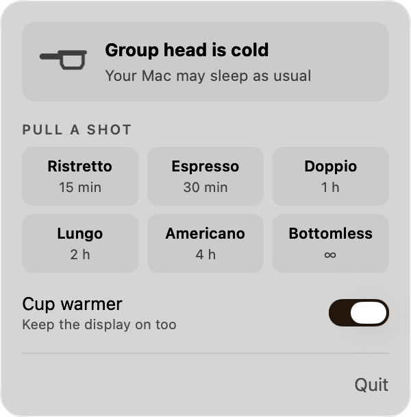
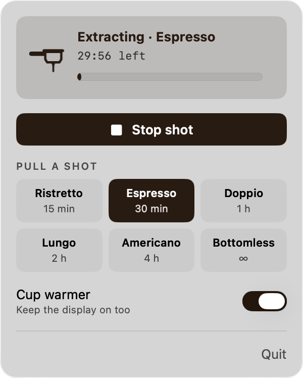

<p align="center">
  
</p>

<h1 align="center">Crema</h1>

<p align="center">
  <strong>Keep your Mac awake, one shot at a time.</strong><br>
  A tiny menu bar app for macOS. Pull a shot, and your Mac stays up until it's done.
</p>

<p align="center">
  
</p>

```sh
brew install --cask theitger/tap/crema
```

---

## Pull a shot

Crema lives in your menu bar as a bottomless portafilter. Click it, pick a shot, and the coffee starts to pour. When the shot is done, your Mac goes back to its normal sleep schedule. No timers to remember, nothing left running.

<p align="center">
  
  &nbsp;&nbsp;
  
</p>

| Shot | Keeps your Mac awake for |
| --- | --- |
| Ristretto | 15 minutes |
| Espresso | 30 minutes |
| Doppio | 1 hour |
| Lungo | 2 hours |
| Americano | 4 hours |
| Bottomless | Until you stop the shot |

## What's in the cup

- **One click.** Six presets, from a quick Ristretto to a Bottomless session for long builds and downloads.
- **Live countdown.** See exactly how much time is left, with a progress bar that fills as the shot runs.
- **Cup warmer.** Decide whether the display stays on too, or only the Mac itself. Your choice is remembered.
- **Stop shot.** End it early with one click or <kbd>⌘</kbd> <kbd>.</kbd>
- **Nothing left behind.** If Crema quits or crashes, the wake lock goes with it. Your Mac can never get stuck awake.
- **Light as a ristretto.** Under 1 MB, no Dock icon, no network access, no tracking.

## How it works

Crema is a friendly face for `caffeinate`, the tool macOS already ships with. Every shot runs:

```sh
caffeinate -i -m [-d] [-t <seconds>] -w <crema pid>
```

| Flag | Meaning |
| --- | --- |
| `-i` | Prevent idle sleep |
| `-m` | Keep the disk spinning |
| `-d` | Keep the display on (only with Cup warmer) |
| `-t` | End automatically after the shot's duration |
| `-w` | Exit as soon as Crema does |

Closing the lid of a MacBook still puts it to sleep. Crema only stops your Mac from dozing off on its own.

## Install

### Homebrew

```sh
brew install --cask theitger/tap/crema
```

### Manual

Download `Crema-<version>.zip` from the [latest release](https://github.com/theitger/crema/releases/latest), unzip it and move `Crema.app` to your Applications folder.

Crema is ad-hoc signed, not notarized by Apple. Homebrew takes care of that for you. If you install manually, macOS will block the first launch. Either allow it under **System Settings > Privacy & Security > Open Anyway**, or run:

```sh
xattr -dr com.apple.quarantine /Applications/Crema.app
```

### Start at login

Add Crema under **System Settings > General > Login Items**.

## Build from source

You need macOS 13 or later and the Xcode Command Line Tools.

```sh
git clone https://github.com/theitger/crema.git
cd crema
./build.sh --install
```

`./build.sh` builds a universal app (Apple Silicon and Intel) into `build/`. Use `--install` to copy it to `/Applications`, or `--release` to create a zip for a GitHub release.

## Requirements

macOS 13 Ventura or later, on Apple Silicon or Intel.

## License

[MIT](LICENSE) © 2026 Tristan Heitger
